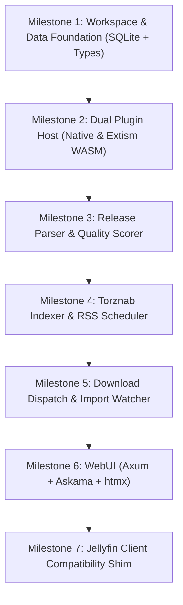

# oxarr Architecture & Implementation Plan

Oxarr is a unified, high-performance media acquisition and streaming daemon written in Rust. It consolidates the disparate *Arr stack (Sonarr, Radarr, Prowlarr) and media server capabilities (Jellyfin client compatibility) into a single, resource-efficient binary designed to idle in tens of megabytes on local NAS storage.

---

## 1. Architectural Principles

1. **Simplicity & Efficiency:** Single binary, in-process SQLite (WAL mode), minimal memory footprint.
2. **Generalized Entity Model:** Unified hierarchy for movies, series, books, comics, and audio instead of siloed data models.
3. **Dual Plugin Engine:**
   - **Native Providers:** Core protocols (Torznab, qBittorrent, TMDB) built directly into the binary with zero overhead.
   - **Wasm/Extism Sandbox:** External/community plugins compiled to `.wasm` running sandboxed with explicit capability grants (allowed network domains).
4. **Phased Execution:** Replace the acquisition/arr stack first; add media delivery and Jellyfin client compatibility once the catalog, release matching, and disk imports are solid.

---

## 2. Workspace Organization

```text
oxarr/
├── Cargo.toml                  # Workspace root
├── devenv.nix                  # Nix/devenv environment definition
├── devenv.yaml                 # devenv inputs (nixpkgs, rust-overlay)
├── docs/                       # Project documentation
│   └── architecture.md         # System architecture and milestones
├── oxarr/
│   ├── types/                  # Canonical shared data structures across host and plugins
│   ├── core/                   # Database access (sqlx/SQLite), config, and plugin registry
│   ├── parser/                 # Release name tokenization and quality scoring engine
│   ├── indexer/                # Torznab client and periodic RSS scheduler
│   └── server/                 # Axum HTTP routes, background worker tasks, WebUI (htmx/Askama)
└── plugins/
    └── tmdb/                   # Reference Wasm metadata plugin
```

---

## 3. Milestones & Implementation Roadmap



### Phase 1: Core Acquisition Foundation (Radarr/Sonarr/Prowlarr Replacement)

- [ ] **Milestone 1: Database & Entities**
  - Setup SQLite via `sqlx` with WAL mode and embedded migrations.
  - Core entities: `Entity` (content hierarchy), `MediaAsset` (files on disk), `ReleaseCandidate`, `QualityProfile`.
- [ ] **Milestone 2: Extensibility Layer**
  - Implement the `MetadataProvider` async trait.
  - Native provider: TMDB HTTP client.
  - External adapter: Extism Wasm runtime runner.
- [ ] **Milestone 3: Release Parsing & Scoring Engine**
  - Parse messy release strings (`Title.Year.Resolution.Source.Codec-Group`).
  - Score candidates against custom user quality rules (e.g., prefer x265, reject CAM).
- [ ] **Milestone 4: Indexer Pipeline**
  - Generic Torznab / Newznab XML search & RSS polling.
  - Automated grab evaluation based on wanted entities.
- [ ] **Milestone 5: Downloader & Importer**
  - qBittorrent Web API client + optional embedded `rqbit`.
  - Disk watcher (`notify`) for download completions.
  - Hardlink / move importer into structured library paths.
- [ ] **Milestone 6: Web Dashboard**
  - Server-rendered HTML via `axum` + `askama` + `htmx`.
  - Live progress bars via Server-Sent Events (SSE).

### Phase 2: Media Server & Jellyfin Compatibility

- [ ] **Milestone 7: Jellyfin Client Compatibility**
  - Jellyfin authentication and library view endpoints (`/Users`, `/Items`).
  - Session reporting and playback info negotiation (`/PlaybackInfo`).
  - Direct Play / HLS stream routing with plugin-configurable transcode command generation.

---

## 4. Technology Decisions

| Domain | Selected Tool | Rationale |
| :--- | :--- | :--- |
| **Language** | Rust (2021 edition) | Minimal memory footprint on NAS, safe concurrency, fast async I/O. |
| **Async Runtime** | `tokio` | Industry standard for network and process concurrency. |
| **Database** | SQLite + `sqlx` (WAL mode) | Zero configuration, in-process speed, embedded migrations. |
| **Web Server** | `axum` + `tower` | Modular, ergonomic async HTTP framework. |
| **Plugin Sandbox** | `extism` (Wasmtime) | Polyglot support, memory-safe sandboxing, network whitelisting. |
| **Web UI** | `askama` + `htmx` | Single self-contained binary, microsecond render times, zero npm bloat. |
| **Environment** | `devenv` | Reproducible development shell with pinned Rust and targets. |
| **VCS** | `jj` (Jujutsu) | Superior local branchless version control with Git compatibility. |
