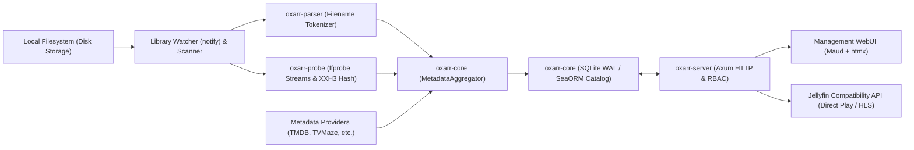

# oxarr Architecture

Oxarr is a unified, high-performance media cataloging, inspection, and streaming daemon written in Rust. It monitors local media libraries, extracts technical stream specifications, parses canonical release nomenclature, aggregates rich metadata across multi-source providers, and provides multi-user role-based access control (RBAC) and media streaming capabilities (Jellyfin client compatibility) in a single binary designed to idle in tens of megabytes on local NAS storage.

---

## 1. Architectural Principles

1. **Simplicity & Efficiency:** Single binary, in-process SQLite (WAL mode), minimal memory footprint.
2. **Hybrid Typed Catalog (Class Table Inheritance):** A shared `UUIDv7`-keyed `entities` base table provides global identity, monitoring, Jellyfin `ItemId` addressing, M:N file mapping (`entity_assets` -> `media_assets`), and multi-user library ownership, while `1:1` per-medium extension tables (starting with `movies` and `collections` + `collection_movies`, extending additively to series, music, and books) enforce strict domain schemas and foreign keys.
3. **Local Inspection & Live Monitoring:**
   - **Filename Parsing:** Independent release name tokenization extracting titles, years, seasons, episodes, video codecs, and normalized resolutions.
   - **Stream Probing & Hashing:** Asynchronous `ffprobe` stream property extraction paired with high-throughput XXH3 content hashing for deduplication and corruption verification.
   - **Filesystem Watcher:** OS-level real-time file event monitoring (`notify`) debounced for quiet windows during file writes.
4. **Multi-Source Metadata Aggregation:**
   - **Pluggable Engine:** Native and Wasm (Extism) providers (TMDB, TVMaze, TheTVDB, OMDb).
   - **Canonical Key Linking:** External IDs (`imdb`, `tmdb`, `tvmaze`) resolved across services for unambiguous entity unification and priority fallbacks.
5. **Multi-User RBAC & Hypermedia UI:**
   - **Access Control:** User accounts with admin flags and library-level grant mappings (`user_libraries`).
   - **Management Dashboard:** Zero-JS-build management dashboard rendered on the server (`axum` + `maud` + `htmx`), paired with a Jellyfin-compatible API surface so existing TV, mobile, and desktop media players work out of the box.

---

## 2. System Data Flow



---

## 3. Workspace Organization

```text
oxarr/
├── AGENTS.md                   # Agent workspace guidelines and roadmap lookup
├── Cargo.toml                  # Workspace root
├── devenv.nix                  # Nix/devenv environment definition
├── devenv.yaml                 # devenv inputs (nixpkgs, rust-overlay)
├── docs/                       # Project documentation
│   └── architecture.md         # System architecture and design principles
├── oxarr/
│   ├── types/                  # Canonical shared data structures across host and plugins
│   ├── core/                   # Database access (SeaORM/SQLite), scanner, watcher, metadata aggregator
│   ├── parser/                 # Media filename tokenization and release parsing engine
│   ├── probe/                  # Media probing and ffprobe inspection engine
│   └── server/                 # Axum HTTP routes, background worker tasks, WebUI, Jellyfin API
└── plugins/
    └── tmdb/                   # Reference Wasm metadata plugin
```

---

## 4. Technology Decisions

| Domain | Selected Tool | Rationale |
| :--- | :--- | :--- |
| **Language** | Rust (2021 edition) | Minimal memory footprint on NAS, safe concurrency, fast async I/O. |
| **Async Runtime** | `tokio` | Industry standard for network and process concurrency. |
| **Database** | SQLite + `sea-orm` (WAL mode) | Zero configuration, in-process speed, type-safe relational queries, and embedded Rust migrations (`sea-orm-migration`). |
| **Inspection & Hashing** | `ffprobe` (headless) + `xxhash-rust` (XXH3) | Stream-level technical details and 10+ GB/s file hashing for cross-server deduplication. |
| **Filesystem Watcher** | `notify` + `notify-debouncer-mini` | Low-latency inotify/kqueue/FSEvents detection with debounced quiet windows. |
| **Web Server** | `axum` + `tower` | Modular, ergonomic async HTTP framework. |
| **Plugin Sandbox** | `extism` (Wasmtime) | Polyglot support, memory-safe sandboxing, network whitelisting. |
| **Web UI** | `maud` + `htmx` | Pure Rust compile-time HTML macro, zero templates/HTML files, microsecond render times, zero npm bloat. |
| **Environment** | `devenv` | Reproducible development shell with pinned Rust and targets. |
