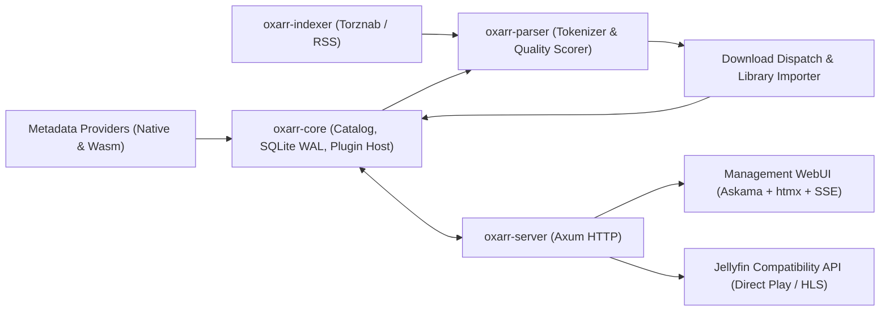

# oxarr Architecture

Oxarr is a unified, high-performance media acquisition and streaming daemon written in Rust. It consolidates the disparate *Arr stack (Sonarr, Radarr, Prowlarr) and media server capabilities (Jellyfin client compatibility) into a single, resource-efficient binary designed to idle in tens of megabytes on local NAS storage.

---

## 1. Architectural Principles

1. **Simplicity & Efficiency:** Single binary, in-process SQLite (WAL mode), minimal memory footprint.
2. **Hybrid Typed Catalog (Class Table Inheritance):** A shared `UUIDv7`-keyed `entities` base table provides global identity, monitoring, quality profile inheritance, Jellyfin `ItemId` addressing, M:N file mapping (`entity_assets` -> `media_assets`), and release tracking (`tracked_releases`), while `1:1` per-medium extension tables (starting with `movies` and `collections` + `collection_movies`, and extending additively to series, custom Wasm media types, music, and books) enforce strict domain schemas and foreign keys. Release selection uses unified condition-based scoring (`QualityProfile` rules).
3. **Dual Plugin Engine:**
   - **Native Providers:** Core protocols (Torznab, qBittorrent, TMDB) built directly into the binary with zero overhead.
   - **Wasm/Extism Sandbox:** External/community plugins compiled to `.wasm` running sandboxed with explicit capability grants (allowed network domains).
4. **Hypermedia UI & Client Compatibility:** Zero-JS-build management dashboard rendered on the server (`axum` + `askama` + `htmx`), paired with a Jellyfin-compatible API surface so existing TV, mobile, and desktop media players work out of the box.

---

## 2. System Data Flow



---

## 3. Workspace Organization

```text
oxarr/
├── AGENTS.md                   # Agent workspace guidelines and roadmap lookup
├── Cargo.toml                  # Workspace root
├── devenv.nix                  # Nix/devenv environment definition
├── devenv.yaml                 # devenv inputs (nixpkgs, rust-overlay)
├── docs/                       # Project documentation
│   └── architecture.md         # System architecture and design principles
├── oxarr/
│   ├── types/                  # Canonical shared data structures across host and plugins
│   ├── core/                   # Database access (SeaORM/SQLite), config, download/import, plugin registry
│   ├── parser/                 # Release name tokenization and quality scoring engine
│   ├── indexer/                # Torznab/Newznab client and periodic RSS scheduler
│   ├── probe/                  # Media probing and ffprobe inspection engine
│   └── server/                 # Axum HTTP routes, background worker tasks, WebUI, Jellyfin API
└── plugins/
    └── tmdb/                   # Reference Wasm metadata plugin
```

---

## 4. Technology Decisions

| Domain | Selected Tool | Rationale |
| :--- | :--- | :--- |
| **Language** | Rust (2021 edition) | Minimal memory footprint on NAS, safe concurrency, fast async I/O. |
| **Async Runtime** | `tokio` | Industry standard for network and process concurrency. |
| **Database** | SQLite + `sea-orm` (WAL mode) | Zero configuration, in-process speed, type-safe relational queries, and embedded Rust migrations (`sea-orm-migration`). |
| **Web Server** | `axum` + `tower` | Modular, ergonomic async HTTP framework. |
| **Plugin Sandbox** | `extism` (Wasmtime) | Polyglot support, memory-safe sandboxing, network whitelisting. |
| **Web UI** | `askama` + `htmx` | Single self-contained binary, microsecond render times, zero npm bloat. |
| **Environment** | `devenv` | Reproducible development shell with pinned Rust and targets. |
